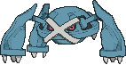
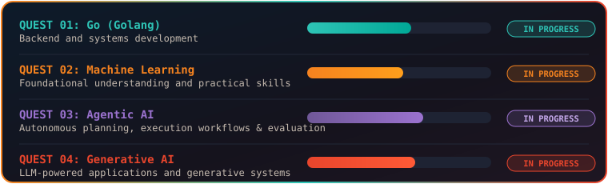
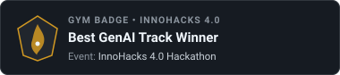
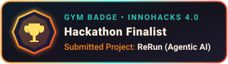
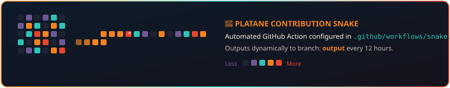

<!-- ================================================================= -->
<!-- 1. HEADER BANNER                                                  -->
<!-- ================================================================= -->
<picture>
  <source media="(prefers-color-scheme: dark)" srcset="https://capsule-render.vercel.app/api?type=waving&color=gradient&customColorList=0,0D1B2A,25,15131D,60,705898,85,E8452C,100,F5821F&height=220&section=header&text=SuperSri%20%7C%20Sridhar%20Manokaran&fontSize=36&fontColor=FFF4E0&animation=fadeIn&desc=Ghost-type%20Trainer%20%E2%80%A2%20Charizard-Powered%20Ambitions&descSize=16&descAlignY=68&descAlign=50">
  <source media="(prefers-color-scheme: light)" srcset="https://capsule-render.vercel.app/api?type=waving&color=gradient&customColorList=0,FFF4E0,30,F5821F,70,E8452C,100,0D1B2A&height=220&section=header&text=SuperSri%20%7C%20Sridhar%20Manokaran&fontSize=36&fontColor=0D1B2A&animation=fadeIn&desc=Ghost-type%20Trainer%20%E2%80%A2%20Charizard-Powered%20Ambitions&descSize=16&descAlignY=68&descAlign=50">
  
</picture>

 

<picture>
  <source media="(prefers-color-scheme: dark)" srcset="https://readme-typing-svg.demolab.com?font=Fira+Code&weight=600&size=19&duration=3000&pause=1000&color=F5821F&center=true&vCenter=true&width=650&height=40&lines=Building+Things%2C+Breaking+Bugs%2C+and+Collecting+XP.;Ghost-type+developer.+Charizard-powered+ambitions.;I+turn+coffee+into+commits+and+commits+into+side+quests.;Software+developer+by+profession%2C+wild+encounter+by+personality.">
  <source media="(prefers-color-scheme: light)" srcset="https://readme-typing-svg.demolab.com?font=Fira+Code&weight=600&size=19&duration=3000&pause=1000&color=E8452C&center=true&vCenter=true&width=650&height=40&lines=Building+Things%2C+Breaking+Bugs%2C+and+Collecting+XP.;Ghost-type+developer.+Charizard-powered+ambitions.;I+turn+coffee+into+commits+and+commits+into+side+quests.;Software+developer+by+profession%2C+wild+encounter+by+personality.">
  
</picture>

  

<!-- ================================================================= -->
<!-- 2. TRAINER CARD                                                   -->
<!-- ================================================================= -->

<table width="100%">
  <tr>
    <td align="center" width="32%" valign="middle">
      
       
      <b><code>NO. 006 — CHARIZARD</code></b>
       
      
      
    </td>
    <td align="left" width="68%" valign="top">
      <h3>📇 TRAINER CARD: SUPERSRI</h3>
      

        🆔 <b>Trainer ID:</b> <code>SS-1923</code> 
        👤 <b>Name:</b> Sridhar Manokaran (<b>SuperSri</b>) 
        🎓 <b>Role:</b> BTech Student, 3rd Year (Information Technology) 
        🏫 <b>Academy:</b> ABV-IIITM Gwalior (Batch 2024–2028) 
        <!-- Location: NOT PROVIDED (TODO: Add your city/country here if you want to display it) -->
        ⏱️ <b>Trainer Since:</b> <code>2024</code> 
        👻 <b>Type Alignment:</b> Ghost <i>(Disappears into terminal, reappears with a commit)</i> 
        🔥 <b>Favorite Pokémon:</b> Charizard <i>(Ordinary avatars lack firepower)</i> 
        ⚡ <b>Special Ability:</b> <b>Bug Haunting</b> — <i>Fixes one bug and occasionally summons three more.</i>
      

    </td>
  </tr>
</table>

 

<!-- ================================================================= -->
<!-- 3. ABOUT ME (POKÉDEX ENTRY)                                       -->
<!-- ================================================================= -->
## 📖 Pokédex Entry: About Me
> *"A wild developer appeared!"*

Hey, I'm **SuperSri** (Sridhar Manokaran), a 3rd-year BTech IT student at ABV-IIITM Gwalior.

I build things that range from agentic AI research frameworks and crude oil supply-chain intelligence to secure cloud storage. I enjoy working on practical engineering problems, experimenting with new technologies, and occasionally creating projects that grow suspiciously bigger than their original scope.

- 🎒 **Current grinding targets:** Go, Machine Learning, Agentic AI, and Generative AI.
- 🔥 **Why Charizard?** Regular profile pictures simply don't have enough firepower.
- 👻 **Why a Ghost-type Trainer?** Because I disappear into the terminal and reappear with a commit.
- 🎯 **Current objective:** Build interesting software, catch bugs, and become slightly harder to replace with a wild Zubat.

 

<!-- ================================================================= -->
<!-- 4. MOVESET (TECH STACK)                                           -->
<!-- ================================================================= -->
## ⚔️ Trainer Moveset (Tech Stack)
> *"My current move set. Some TMs are still downloading."*

### ⚡ Languages — Electric-type Moves: Thunderbolt
> *High-voltage execution across core algorithms and systems.*

  
  
  
  
  

### 🔮 Frameworks — Psychic-type Moves: Future Sight
> *Architecting scalable application backends and dynamic web interfaces.*

  
  
  
  
  
  
  

### 🛡️ Databases — Steel-type Moves: Iron Defense
> *Fortified schemas and rock-solid relational resilience against corruption.*

  
  
  
  
  

### 👻 Tools & Security — Ghost-type Moves: Phantom Force
> *Disappears into the terminal, reappears with precision commits and zero traces.*

  
  
  
  
  
  
  
  

### 🌪️ Cloud — Flying-type Moves: Sky Drop
> *High-altitude infrastructure and secure object storage delivery.*

  
  

### 🧠 AI & Intelligent Systems — Psychic-type Moves: Mind Reader
> *Autonomous agents, structured hypothesis spaces, and probabilistic reasoning.*

  
  
  
  
  
  

 

<!-- ================================================================= -->
<!-- 5. MY PARTY (TOP PROJECTS)                                        -->
<!-- ================================================================= -->
## 🐾 My Party (Featured Projects)
> *"Evidence that the XP grind is real."*

| 
 **[ReRun](https://github.com/sridhar1923/ReRun)** <code>PARTY SLOT 01 • PSYCHIC-TYPE AUTOMATION</code>
 | 
 **[Vantage](https://github.com/sridhar1923/Vantage-Backend)** <code>PARTY SLOT 02 • STEEL/PSYCHIC INTEL</code>
 |
| :--- | :--- |
| 🔮 **Signature Move:** *Future Sight — "Research has entered the battle."*  Developed an agentic AI framework for automated scientific experimentation, structuring research around hypotheses, experiment plans, execution attempts, and evidence-backed conclusions. Uses typed state models with Pydantic v2 and Docker-sandboxed execution with frozen benchmark datasets.  🛠️ **Tech Stack:** `Python` • `Pydantic v2` • `Agentic AI` • `LLMs` • `Docker`  👉 [**Inspect Repository: github.com/sridhar1923/ReRun →**](https://github.com/sridhar1923/ReRun) | 🧠 **Signature Move:** *Strategic Mind — "The supply chain is the battlefield."*  AI-driven crude oil supply-chain intelligence platform evaluating geopolitical disruptions, transit bottlenecks, and national supply vulnerabilities. Built a disruption simulator and decision-support system evaluating alternative suppliers, transit routes, and 30-day trajectories.  🛠️ **Tech Stack:** `Python` • `FastAPI` • `React` • `MongoDB` • `AI/ML` • `Geospatial Analysis`  👉 [**Inspect Repository: github.com/sridhar1923/Vantage-Backend →**](https://github.com/sridhar1923/Vantage-Backend) |
| 
 **[Aegis](https://github.com/sridhar1923/aegis)** <code>PARTY SLOT 03 • STEEL-TYPE SECURITY</code>
 | 
 **[CozyCompanions](https://github.com/sridhar1923/CozyCompanions-Public)** <code>PARTY SLOT 04 • SUPPORT-TYPE WELL-BEING</code>
 |
| 🛡️ **Signature Move:** *Iron Defense — "Your files. Your keys. Your fortress."*  Secure cloud storage and sharing platform featuring client-side file encryption/decryption using WebCrypto and Node-Forge, key-pair generation, and encrypted transfer workflows. Backed by AWS S3 and containerized with Docker.  🛠️ **Tech Stack:** `FastAPI` • `React` • `PostgreSQL` • `AWS S3` • `WebCrypto` • `Node-Forge` • `Docker` • `SQLAlchemy`  👉 [**Inspect Repository: github.com/sridhar1923/aegis →**](https://github.com/sridhar1923/aegis) | 💖 **Signature Move:** *Heal Pulse — "Self-care, but with XP."*  Gamified mental-health tracking application with daily mood check-ins, journaling, progression mechanics, and customizable virtual companions. Features XP, streaks, coins, pet hatching, and avatar customization.  🛠️ **Tech Stack:** `Django` • `HTML` • `CSS` • `JavaScript` • `PostgreSQL` • `SQLite`  👉 [**Inspect Repository: github.com/sridhar1923/CozyCompanions-Public →**](https://github.com/sridhar1923/CozyCompanions-Public) |

<!-- Note: Party slots 5 & 6 reserved for upcoming repositories -->
<!-- TODO: Add 5th and 6th party members when new projects are ready -->

 

<!-- ================================================================= -->
<!-- 6. CURRENTLY TRAINING                                             -->
<!-- ================================================================= -->
## 🎯 Currently Training (Quest Log)
> *"New quests unlocked. Experience points required."*

  

 

<!-- ================================================================= -->
<!-- 7. EVOLUTION PATH (TIMELINE)                                      -->
<!-- ================================================================= -->
## 📈 Evolution Path
> *Milestone trajectory from foundational training to full-stack engineering.*

<b>📜 Click to inspect Trainer Journey & Research Log</b>

 

<table width="100%">
  <thead>
    <tr>
      <th width="20%" align="left">Timeline</th>
      <th width="25%" align="left">Milestone Type</th>
      <th width="55%" align="left">Details &amp; Field Notes</th>
    </tr>
  </thead>
  <tbody>
    <tr>
      <td><b>2024 – 2028</b></td>
      <td>🎓 <b>Education</b></td>
      <td><b>BTech in Information Technology</b> Atal Bihari Vajpayee Indian Institute of Information Technology and Management, Gwalior (<i>ABV-IIITM Gwalior</i>) • <b>Current Status: 3rd Year</b></td>
    </tr>
    <tr>
      <td><b>October 2026</b></td>
      <td>🚀 <b>Project Release</b></td>
      <td><b><a href="https://github.com/sridhar1923/ReRun">ReRun</a></b> — Autonomous research experimentation framework powered by agentic AI, typed state machines, and Docker sandboxes.</td>
    </tr>
    <tr>
      <td><b>May 2026</b></td>
      <td>🚀 <b>Project Release</b></td>
      <td><b><a href="https://github.com/sridhar1923/Vantage-Backend">Vantage</a></b> — AI-driven crude oil supply-chain intelligence and geopolitical transit risk simulator.</td>
    </tr>
    <tr>
      <td><b>January 2026</b></td>
      <td>🚀 <b>Project Release</b></td>
      <td><b><a href="https://github.com/sridhar1923/aegis">Aegis</a></b> — Secure cloud file storage platform with client-side WebCrypto encryption and AWS S3 integration.</td>
    </tr>
    <tr>
      <td><i>Milestone</i></td>
      <td>🎮 <b>Project Release</b></td>
      <td><b><a href="https://github.com/sridhar1923/CozyCompanions-Public">CozyCompanions</a></b> — Gamified mental-health tracker with daily check-ins, mood journaling, and companion hatching mechanics.</td>
    </tr>
  </tbody>
</table>

 

<!-- ================================================================= -->
<!-- 8. GYM BADGES                                                     -->
<!-- ================================================================= -->
## 🏅 Gym Badges Earned
> *"Not every battle ends in victory. This one came with a badge."*

  
  &nbsp;
  

 

<!-- ================================================================= -->
<!-- 9. TRAINER STATS                                                  -->
<!-- ================================================================= -->
## 📊 Trainer Stats
> *Telemetry transmitted from the GitHub arena.*

  <picture>
    <source media="(prefers-color-scheme: dark)" srcset="https://github-readme-stats.vercel.app/api?username=sridhar1923&show_icons=true&locale=en&theme=tokyonight&bg_color=0D1B2A&title_color=F5821F&icon_color=2EC4B6&text_color=FFF4E0&border_color=E8452C">
    <source media="(prefers-color-scheme: light)" srcset="https://github-readme-stats.vercel.app/api?username=sridhar1923&show_icons=true&locale=en&theme=default&bg_color=FFF4E0&title_color=E8452C&icon_color=0D1B2A&text_color=0D1B2A&border_color=F5821F">
    
  </picture>
  <picture>
    <source media="(prefers-color-scheme: dark)" srcset="https://streak-stats.demolab.com/?user=sridhar1923&theme=tokyonight&background=0D1B2A&border=E8452C&stroke=F5821F&ring=F5821F&fire=F5821F&currStreakNum=FFF4E0&sideNums=FFF4E0&currStreakLabel=2EC4B6&sideLabels=2EC4B6&dates=FFF4E0">
    <source media="(prefers-color-scheme: light)" srcset="https://streak-stats.demolab.com/?user=sridhar1923&theme=default&background=FFF4E0&border=F5821F&stroke=E8452C&ring=E8452C&fire=E8452C&currStreakNum=0D1B2A&sideNums=0D1B2A&currStreakLabel=0D1B2A&sideLabels=0D1B2A&dates=0D1B2A">
    
  </picture>
    
  <picture>
    <source media="(prefers-color-scheme: dark)" srcset="https://github-readme-stats.vercel.app/api/top-langs/?username=sridhar1923&layout=compact&bg_color=0D1B2A&title_color=F5821F&text_color=FFF4E0&border_color=E8452C">
    <source media="(prefers-color-scheme: light)" srcset="https://github-readme-stats.vercel.app/api/top-langs/?username=sridhar1923&layout=compact&bg_color=FFF4E0&title_color=E8452C&text_color=0D1B2A&border_color=F5821F">
    
  </picture>

 

<!-- ================================================================= -->
<!-- 10. CONTRIBUTION SNAKE                                            -->
<!-- ================================================================= -->
## 🐍 Contribution Snake
> *Platane Snake consuming commits across the Pokémon tall grass.*

  <picture>
    <source media="(prefers-color-scheme: dark)" srcset="https://raw.githubusercontent.com/sridhar1923/sridhar1923/output/github-contribution-grid-snake-dark.svg">
    <source media="(prefers-color-scheme: light)" srcset="https://raw.githubusercontent.com/sridhar1923/sridhar1923/output/github-contribution-grid-snake-light.svg">
    
  </picture>

 

<!-- ================================================================= -->
<!-- 11. POKÉGEAR (CONTACT)                                            -->
<!-- ================================================================= -->
## 📟 Pokégear (Contact & Profiles)
> *Got a quest, an engineering challenge, or a legendary bug encounter? Let's connect.*

  
  &nbsp;
  
  &nbsp;
  
  &nbsp;
  
  &nbsp;
  

 

<!-- ================================================================= -->
<!-- 12. SECRET BASE (FUN FACTS)                                       -->
<!-- ================================================================= -->
## ⛺ Secret Base (Fun Facts & Lore)

<b>🔍 Tap to enter SuperSri's Secret Base</b>

 

- 🐲 **Signature Mascot:** Charizard. *The official reasoning is that regular profile pictures simply lack sufficient firepower.*
- 👻 **Trainer Type Alignment:** Ghost. Charizard is the mascot, Ghost is the personality. Type compatibility was never part of the selection equation.
- 💻 **Primary Battle Station OS:** **Pop!_OS** (Linux enthusiast).
- 🎮 **Favourite Pokémon Game:** *None officially registered — purely lore & battle mechanics focused.*
- ⚔️ **Special Passive Habit:** Fixing one bug and accidentally unlocking a three-bug boss fight.
- 🎨 **Side Quests:** Building ambitious side projects, desktop pet concepts, pixel art experimentation, and exploring Linux customization.

 

<!-- ================================================================= -->
<!-- 13. FOOTER                                                        -->
<!-- ================================================================= -->

  

  

    🔥 <b>Gotta commit 'em all!</b> 🔥 
    <i>"Thanks for visiting. Charizard handled the flames; I'm still handling the merge conflicts."</i>
  

  

    
  
    ⚠️ <i>Disclaimer: Pokémon and Pokémon character names are trademarks of Nintendo, Creatures Inc., and Game Freak. This GitHub profile is an unofficial fan tribute.</i>
  

